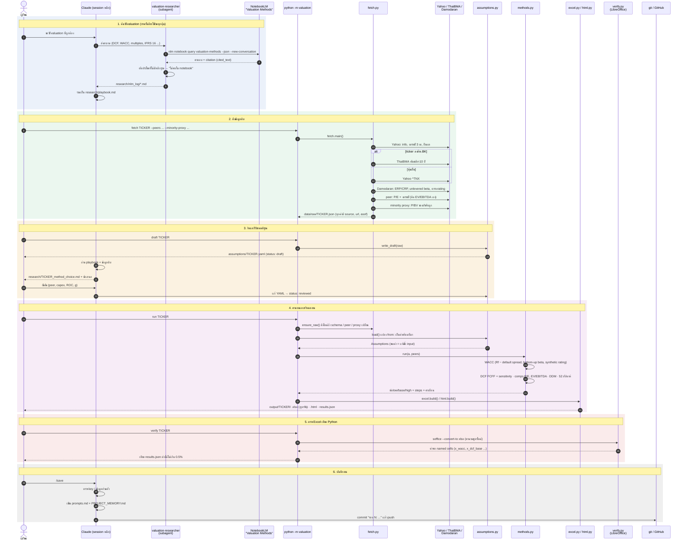

# Workflow ของโปรแกรม (ภาพรวม)

> ลำดับการทำงานตั้งแต่ค้นวิธี valuation จนได้ Excel และ HTML ของหุ้น 1 ตัว อัปเดต 2026-10-31
> GitHub แสดงแผนภาพ mermaid ในไฟล์นี้ให้เอง

## Sequence diagram



## ไฟล์ที่เกี่ยวข้องในแต่ละขั้น

| ขั้น | โค้ด / คำสั่ง | ไฟล์ที่ได้ |
|---|---|---|
| 1. ค้นวิธี | `.claude/agents/valuation-researcher.md` · `nlm` CLI | `research/nlm_log/*.md` · `research/playbook.md` · `research/sources.md` |
| 2. ดึงข้อมูล | `valuation/fetch.py` · `config.yaml` | `data/raw/<TICKER>.json` (ไม่ commit) |
| 3. สมมติฐาน | `valuation/assumptions.py` | `assumptions/<TICKER>.yaml` · `research/<TICKER>_method_choice.md` |
| 4. คำนวณ | `valuation/pipeline.py` · `methods.py` · `excel.py` · `html.py` · `templates/report.html` | `output/<TICKER>/<TICKER>_valuation.xlsx` · `.html` · `_results.json` |
| 5. ตรวจ | `valuation/verify.py` (ต้องมี LibreOffice) | ผลเทียบในเทอร์มินัล |
| 6. บันทึก | `.claude/commands/save.md` | `prompts.md` · `PROJECT_MEMORY.md` · commit บน GitHub |

## คำสั่งที่ใช้บ่อย

```bash
.venv/bin/python -m valuation run CPALL.BK
```

```bash
.venv/bin/python -m valuation verify CPALL.BK
```

หุ้นตัวใหม่: `draft <TICKER>` → รีวิว `assumptions/<TICKER>.yaml` (เพิ่ม peers, methods, method_reasons) → `run <TICKER>` → `verify <TICKER>`
