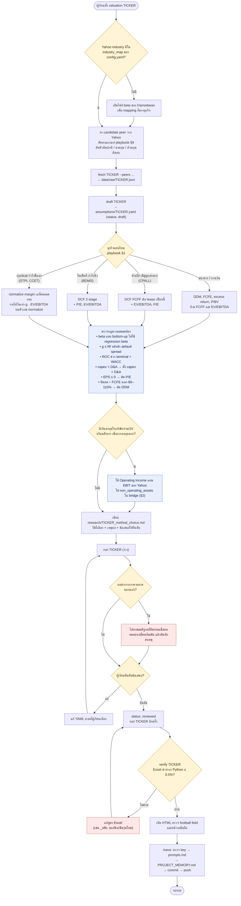
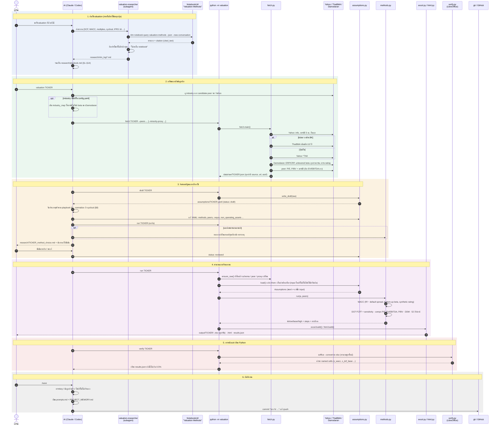

# Workflow ของโปรแกรม (ภาพรวม)

> ลำดับการทำงานตั้งแต่ค้นวิธี valuation จนได้ Excel และ HTML ของหุ้น 1 ตัว อัปเดต 2026-11-03 (หลังทำ CPALL, BDMS, STPI และร่าง CCET)
> มี 2 แผนภาพ: **workflow** บอกว่าต้องตัดสินใจอะไรตรงไหน ส่วน **sequence diagram** บอกว่าใครส่งอะไรให้ใคร
> GitHub แสดงแผนภาพ mermaid ในไฟล์นี้ให้เอง

## 1. Workflow: จุดตัดสินใจของหุ้น 1 ตัว



## 2. Sequence diagram: ใครส่งอะไรให้ใคร



## ไฟล์ที่เกี่ยวข้องในแต่ละขั้น

| ขั้น | โค้ด / คำสั่ง | ไฟล์ที่ได้ |
|---|---|---|
| 1. ค้นวิธี | `.claude/agents/valuation-researcher.md` (Codex ใช้ `.codex/agents/valuation-researcher.toml`) · `nlm` CLI | `research/nlm_log/*.md` · `research/playbook.md` · `research/sources.md` |
| 2. ดึงข้อมูล | `valuation/fetch.py` · `config.yaml` (industry_map) | `data/raw/<TICKER>.json` (ไม่ commit) |
| 3. สมมติฐาน | `valuation/assumptions.py` | `assumptions/<TICKER>.yaml` · `research/<TICKER>_method_choice.md` |
| 4. คำนวณ | `valuation/pipeline.py` · `methods.py` · `excel.py` · `html.py` · `templates/report.html` | `output/<TICKER>/<TICKER>_valuation.xlsx` · `.html` · `_results.json` |
| 5. ตรวจ | `valuation/verify.py` (ต้องมี LibreOffice) | ผลเทียบในเทอร์มินัล |
| 6. บันทึก | `.claude/commands/save.md` | `prompts.md` · `PROJECT_MEMORY.md` · commit บน GitHub |

## หุ้นที่ผ่าน workflow นี้แล้ว

| หุ้น | ประเภทธุรกิจ (§1) | วิธีที่ใช้ | สถานะ |
|---|---|---|---|
| CPALL.BK | ค้าปลีก สัญญาเช่ามาก | DCF FCFF, P/E, EV/EBITDA, 52 สัปดาห์ | reviewed |
| BDMS.BK | โตเต็มที่ (โรงพยาบาล) | DCF FCFF, P/E, EV/EBITDA, 52 สัปดาห์ | reviewed |
| STPI.BK | cyclical + เงินลงทุนมาก | DCF normalize + non_operating_assets, EV/EBITDA normalize, P/BV, 52 สัปดาห์ | reviewed |
| CCET.BK | cyclical (ฮาร์ดแวร์/EMS) | DCF normalize, P/E, EV/EBITDA, 52 สัปดาห์ | draft |

## คำสั่งที่ใช้บ่อย

```bash
.venv/bin/python -m valuation run CPALL.BK
```

```bash
.venv/bin/python -m valuation verify CPALL.BK
```

หุ้นตัวใหม่: เพิ่ม industry_map ถ้ายังไม่มี → `fetch <TICKER> --peers ...` → `draft <TICKER>` → แก้ `assumptions/<TICKER>.yaml` และเขียน `research/<TICKER>_method_choice.md` → `run <TICKER>` → ผู้เรียนยืนยัน → `status: reviewed` → `run` → `verify`
